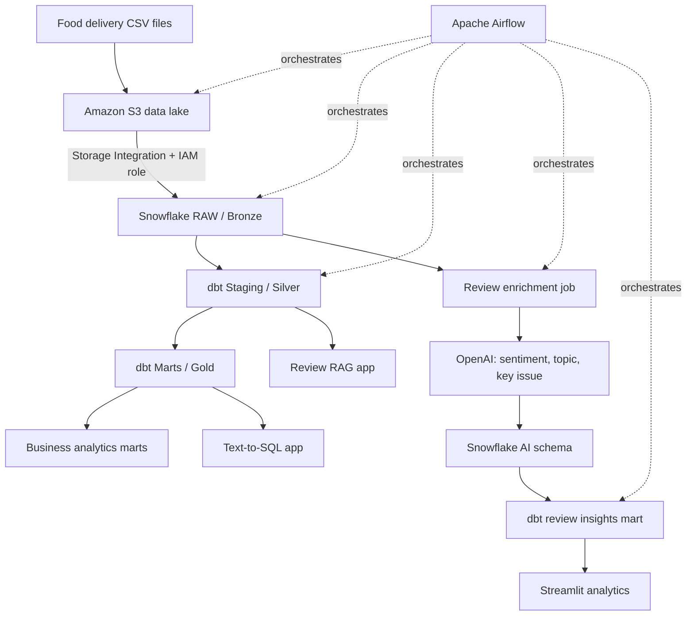

<div align="center">

# Zomato AI Data Engineering Platform

### From raw food-delivery data to a cloud data warehouse and AI-powered analytics

<p>
  
  
  
  
  
  
  
</p>

**A batch data engineering project that combines cloud ingestion, warehouse modelling, orchestration, and generative AI.**

</div>

---

## Overview

This project builds an end-to-end analytics platform for Zomato-style food-delivery data. It moves source CSV files into an Amazon S3 data lake, loads them into Snowflake, transforms them with dbt using a medallion-style architecture, and orchestrates the workflow with Apache Airflow.

An AI layer extends the warehouse with review enrichment, retrieval-augmented generation (RAG), and natural-language-to-SQL analytics. Streamlit provides lightweight interfaces for exploring review insights and asking questions of the warehouse.

**End-to-end flow**

`CSV datasets → Amazon S3 → Snowflake → dbt → Airflow → OpenAI-powered analytics → Streamlit`

> **Dataset note:** The source data directory is intentionally excluded from this repository because the CSV collection is large. See [Dataset access](#dataset-access) for the project dataset location and expected files.

## Architecture



The repository also includes a visual architecture asset at [`docs/architecture.png`](docs/architecture.png).

## What the project implements

| Component | Technology | Implementation |
|---|---|---|
| Data lake | Amazon S3 | Organises the seven CSV sources under `raw/<table>/` prefixes. |
| Secure ingestion | Snowflake Storage Integration + AWS IAM | Allows Snowflake to read the S3 bucket through an IAM role rather than embedding AWS access keys in SQL. |
| Raw warehouse layer | Snowflake | Creates RAW tables and loads source files with `COPY INTO`. |
| Transformation | dbt Core + dbt-snowflake | Builds staging views, dimensional models, incremental fact tables, and business-facing marts. |
| Data quality | dbt tests | Applies uniqueness, not-null, accepted-value, relationship, and project-specific checks where configured. |
| Orchestration | Apache Airflow 3 | Runs the batch workflow through a daily DAG. |
| LLM enrichment | OpenAI API | Extracts sentiment, sentiment score, topic, and key issue from customer review text. |
| Retrieval | Embeddings + cosine similarity | Retrieves relevant reviews to ground natural-language answers. |
| Natural-language analytics | OpenAI + Snowflake SQL | Generates read-oriented SQL from questions and displays query results. |
| User interface | Streamlit | Provides separate review-chat and warehouse-query applications. |

## Dataset

The project is designed around seven source files:

| Dataset | Type | Purpose |
|---|---|---|
| `restaurants.csv` | Dimension | Restaurant attributes such as city, cuisine, rating, and cost. |
| `users.csv` | Dimension | Customer attributes. |
| `food.csv` | Dimension | Food item details and dietary classification. |
| `menu.csv` | Dimension / mapping | Restaurant menu and food-item relationships. |
| `orders.csv` | Fact | Order-level transactions and delivery attributes. |
| `order_items.csv` | Fact | Item-level details for each order. |
| `reviews.csv` | Fact / text | Customer ratings and free-text comments. |

The project documentation describes generated fact data at approximately **10 million orders**, **23 million order items**, and **300,000 reviews**. Actual loaded counts depend on the dataset version and the results of the Snowflake load; validate them with the count queries in `snowflake/05_copy_into.sql`.

### Dataset access

The CSV data is not committed to GitHub because of its size. The original project dataset is available through this [Google Drive folder](https://drive.google.com/drive/folders/1FEnGWMHhHzzTUCZOw1-YnH2v3DMuM-rs?usp=sharing). Download the files and place them in the local `data/` directory before uploading them to S3.

Expected S3 layout:

```text
s3://<YOUR_BUCKET>/
└── raw/
    ├── restaurants/
    ├── users/
    ├── food/
    ├── menu/
    ├── orders/
    ├── order_items/
    └── reviews/
```

Each prefix should contain its corresponding CSV file.

## Data architecture: Medallion layers

### 1. Bronze — raw ingestion

**Location:** `ZOMATO.RAW`

- Defines Snowflake tables whose columns align with the source CSV structure.
- Uses an external stage backed by the S3 storage integration.
- Loads the files with `COPY INTO`.
- Keeps source values close to their original form so that downstream transformations remain reproducible.

Key SQL files: [`01_setup.sql`](snowflake/01_setup.sql), [`02_storage_integration.sql`](snowflake/02_storage_integration.sql), [`03_stage_and_formats.sql`](snowflake/03_stage_and_formats.sql), [`04_raw_tables.sql`](snowflake/04_raw_tables.sql), and [`05_copy_into.sql`](snowflake/05_copy_into.sql).

### 2. Silver — staging and standardisation

**Location:** `ZOMATO.STAGING`

The dbt staging models provide a consistent layer between raw ingestion and analytics. They select and rename source columns, standardise values, cast fields, and derive useful attributes. Examples include normalising restaurant cost values, cleaning customer email fields, and deriving delivery flags.

The project contains seven staging models, one for each source table:

- `stg_restaurants`
- `stg_users`
- `stg_food`
- `stg_menu`
- `stg_orders`
- `stg_order_items`
- `stg_reviews`

### 3. Gold — dimensional models and marts

**Location:** `ZOMATO.MARTS`

The Gold layer is designed for analytical queries and business reporting.

**Dimensions**

- `dim_restaurants`
- `dim_customer`
- `dim_food`
- `dim_date`

**Incremental fact models**

- `fct_orders`
- `fact_order_items`

The fact models use dbt incremental materialisation with a `merge` strategy and configured unique keys. This is intended to process new or changed records without rebuilding the full fact table on every run. The incremental filter uses the latest timestamp already present in the target model.

**Business marts**

| Model | Analytical purpose |
|---|---|
| `mart_daily_city_revenue`* | Daily order volume, GMV, average order value, and cancellation rate by city. |
| `mart_restaurant_performance` | Restaurant-level order, revenue, rating, and cancellation metrics. |
| `mart_delivery_sla` | Delivery-time percentiles and late-delivery indicators by city and hour. |
| `mart_review_insights` | Aggregated review sentiment and topic insights from the AI-enriched review table. |

*The SQL filename currently uses `mart_daily_city_revenune.sql`; the model name should be checked against the compiled dbt relation before referencing it in downstream tools.*

### Data quality

The dbt YAML files define tests including:

- `unique`
- `not_null`
- `relationships`
- `accepted_values`

Run `dbt test` or `dbt build` to execute the configured checks alongside model builds. The tests that run are those actually declared in the project files; additional reconciliation checks can be added as the model suite evolves.

## Airflow orchestration

The Airflow DAG is defined in [`airflow/dags/zomato_batch.py`](airflow/dags/zomato_batch.py). It is configured to run daily and chains the batch workflow in dependency order:

```text
reload_raw → dbt_build_core → enrich_reviews → dbt_build_ai
```

| Task | Responsibility |
|---|---|
| `reload_raw` | Executes Snowflake `COPY INTO` statements for the raw source tables. |
| `dbt_build_core` | Builds the non-AI dbt models and runs their configured tests. |
| `enrich_reviews` | Runs the Python job that enriches reviews using the OpenAI API. |
| `dbt_build_ai` | Builds dbt models tagged `ai`, including the review insights mart. |

Airflow 3 runs in Docker Compose with a PostgreSQL metadata database, API server, scheduler, and DAG processor. The Airflow image installs the Snowflake and FAB providers, OpenAI client, and a separate virtual environment for dbt.

## AI capabilities

### 1. LLM-based review enrichment

**File:** `ai/enrich_reviews.py`

The enrichment job reads reviews that do not yet have a corresponding record in `ZOMATO.AI.REVIEW_ENRICHED`, sends the review text to `gpt-4o-mini`, and stores structured output in Snowflake.

| Output field | Description |
|---|---|
| `SENTIMENT_LABEL` | Positive, negative, or neutral classification. |
| `SENTIMENT_SCORE` | Numeric sentiment score between -1 and 1. |
| `TOPIC` | Review topic such as food quality, delivery, pricing, service, or packaging. |
| `KEY_ISSUE` | Short phrase describing the main issue, when present. |
| `MODEL` | Model identifier used for enrichment. |
| `ENRICHED_AT` | Timestamp when the record was created. |

The current script sets `SAMPLE_N = 5` in code. This is a small demonstration batch, not a full 300,000-review enrichment run. API usage and cost will increase if the sample size is raised.

### 2. Retrieval-augmented generation (RAG)

**File:** `ai/rag_chat.py`

The review-chat application:

1. Reads a sample of reviews from the Snowflake staging layer.
2. Creates embeddings using `text-embedding-3-small`.
3. Compares a question embedding with review embeddings using cosine similarity.
4. Retrieves the top matching reviews.
5. Uses `gpt-4o-mini` to generate an answer grounded in the retrieved review text.
6. Displays the reviews used as context alongside the answer.

This implementation uses a local Parquet cache and in-process similarity calculations; it does not currently use a dedicated vector database.

### 3. Text-to-SQL analytics

**File:** `ai/text_to_sql.py`

The warehouse-chat application accepts a natural-language question, provides the LLM with a schema description of selected marts, generates SQL, applies a basic read-query validation check, and executes the query against Snowflake using the `DBT_ROLE` connection.

> **Security note:** The current SQL validation is a lightweight project safeguard, not a production-grade SQL security boundary. Before exposing this app to users, enforce read-only permissions in Snowflake, use a strict SQL parser or query allowlist, apply query timeouts and row limits, and test adversarial prompts. Never rely on an LLM prompt or keyword blacklist as the only access-control mechanism.

## Repository structure

```text
.
├── airflow/
│   ├── dags/
│   │   └── zomato_batch.py        # Daily orchestration DAG
│   ├── Dockerfile                 # Airflow image and Python/dbt dependencies
│   ├── docker-compose.yaml        # Airflow services and PostgreSQL
│   └── example.env                # Environment-variable template
│
├── ai/
│   ├── enrich_reviews.py          # LLM review enrichment
│   ├── rag_chat.py                # Review RAG Streamlit app
│   ├── text_to_sql.py             # Natural-language-to-SQL app
│   └── example.env                # AI/Snowflake environment template
│
├── aws/
│   └── iam/
│       ├── s3-read-policy.json
│       ├── snowflake-role-trust-policy-initial.json
│       └── snowflake-role-trust-policy-final.json
│
├── docs/
│   └── architecture.png
│
├── snowflake/
│   ├── 01_setup.sql               # Warehouse, database, schemas, role
│   ├── 02_storage_integration.sql # S3 storage integration
│   ├── 03_stage_and_formats.sql   # External stage and CSV format
│   ├── 04_raw_tables.sql          # Raw table definitions
│   └── 05_copy_into.sql           # S3-to-Snowflake load statements
│
├── zomato/
│   ├── models/
│   │   ├── staging/               # Silver staging views and source definitions
│   │   └── marts/                 # Gold dimensions, facts, and marts
│   ├── macros/                    # Custom dbt schema naming macro
│   └── dbt_project.yml
│
├── .gitignore
└── README.md
```

## Getting started

This is a cloud-integrated project. A complete run requires AWS, Snowflake, and OpenAI credentials, plus access to the dataset. The local Airflow services run through Docker Compose.

### Prerequisites

- AWS account with permission to create an S3 bucket and IAM policy/role.
- Snowflake account with permission to create a warehouse, database, schemas, role, stage, and storage integration.
- OpenAI API key with access to the configured models.
- Docker Desktop with Docker Compose.
- Python and dbt-snowflake for running dbt locally (optional if using the supplied Airflow container for orchestration).

### Step 1 — Prepare the dataset and S3 bucket

1. Download the seven CSV files from the [dataset folder](https://drive.google.com/drive/folders/1FEnGWMHhHzzTUCZOw1-YnH2v3DMuM-rs?usp=sharing).
2. Create an S3 bucket.
3. Upload each CSV to its matching `raw/<table>/` prefix as shown in the [dataset layout](#dataset).

### Step 2 — Configure AWS and Snowflake access

1. Update the bucket placeholders in `aws/iam/s3-read-policy.json` and the trust-policy files.
2. Create the S3 read policy and IAM role in AWS.
3. Run `snowflake/01_setup.sql` in Snowsight.
4. Run `snowflake/02_storage_integration.sql` after replacing the role ARN and bucket placeholders.
5. Run `DESC INTEGRATION ZOMATO_S3_INT` and copy the returned `STORAGE_AWS_IAM_USER_ARN` and `STORAGE_AWS_EXTERNAL_ID` into the final IAM trust policy.
6. Apply the final trust policy to the IAM role.
7. Run `snowflake/03_stage_and_formats.sql` after replacing the bucket placeholder.
8. Run `snowflake/04_raw_tables.sql`, then `snowflake/05_copy_into.sql`.

**Important:** Do not re-create the storage integration after configuring the IAM trust relationship unless you also update the trust policy with the newly generated external ID. Keep AWS credentials and account-specific identifiers out of committed files.

### Step 3 — Configure dbt

Create `zomato/profiles.yml` locally. This file is ignored by Git and should not be committed.

```yaml
zomato:
  target: dev
  outputs:
    dev:
      type: snowflake
      account: "{{ env_var('SNOWFLAKE_ACCOUNT') }}"
      user: "{{ env_var('SNOWFLAKE_USER') }}"
      password: "{{ env_var('SNOWFLAKE_PASSWORD') }}"
      role: DBT_ROLE
      database: ZOMATO
      warehouse: ZOMATO_WH
      schema: RAW
      threads: 4
```

Set the Snowflake environment variables in your shell, install dbt-snowflake, and run:

```bash
cd zomato
python -m pip install "dbt-snowflake==1.8.*"
dbt debug
dbt build --exclude tag:ai
```

### Step 4 — Configure and start Airflow

From the repository root:

```bash
cp airflow/example.env airflow/.env
```

Edit `airflow/.env` and supply your own values:

```dotenv
SNOWFLAKE_ACCOUNT=your_account_identifier
SNOWFLAKE_USER=your_username
SNOWFLAKE_PASSWORD=your_password
SNOWFLAKE_WAREHOUSE=ZOMATO_WH
SNOWFLAKE_DATABASE=ZOMATO
SNOWFLAKE_SCHEMA=RAW
OPENAI_API_KEY=your_openai_api_key
```

Then start the Airflow stack:

```bash
cd airflow
docker compose build
docker compose up -d
```

Open [http://localhost:8080](http://localhost:8080), sign in using the local credentials created by the Compose initialisation command, unpause `zomato_batch`, and trigger the DAG. The current Compose configuration creates a local development admin account with the credentials `admin` / `admin`; change these before using the stack beyond a local demonstration.

### Step 5 — Run the AI applications

For local execution, install the Python dependencies used by the AI scripts:

```bash
python -m pip install openai snowflake-connector-python python-dotenv streamlit pandas numpy pyarrow
```

Copy and edit the AI environment template:

```bash
cp ai/example.env .env
```

Populate the Snowflake settings and `OPENAI_API_KEY` in `.env`, then run the desired app from the repository root:

```bash
# Optional: run the review-enrichment job
python ai/enrich_reviews.py

# Chat with customer reviews
streamlit run ai/rag_chat.py

# Ask questions about warehouse marts
streamlit run ai/text_to_sql.py
```

The RAG application reads a review sample from Snowflake and caches embeddings in `review_embeddings.parquet` relative to the current working directory. Generated cache files should not be committed.

## Configuration and security

- Never commit `.env`, API keys, Snowflake passwords, AWS credentials, or `zomato/profiles.yml`.
- Keep the supplied `example.env` files as templates only; replace placeholder values locally.
- The `users` source includes a `password` field in its raw table definition. Treat the dataset as sensitive: do not publish raw customer records or credentials, and remove or mask sensitive fields before sharing data or deploying the pipeline.
- Use least-privilege IAM permissions and Snowflake roles. The supplied S3 policy is intended for read access to the specified bucket.
- Review OpenAI data handling, API usage, and cost before processing customer review text.
- The sample Airflow Compose setup is for local development, not a hardened production deployment. Change default credentials and secrets, configure access controls, and review network exposure before deployment.

## Current implementation scope and next improvements

The repository demonstrates the end-to-end design and the core components described above. A few useful next steps before treating it as a production deployment:

- Add automated integration tests for the S3-to-Snowflake load and full Airflow DAG.
- Add a dbt snapshot definition if historical SCD Type 2 tracking is required; the current `snapshots/` directory is only a placeholder.
- Make review enrichment batch size configurable and add retry/backoff, rate-limit handling, and structured failure logging.
- Replace the lightweight text-to-SQL keyword check with parser-based validation and enforce read-only Snowflake permissions.
- Add monitoring, alerting, freshness checks, and operational runbooks.
- Add screenshots of successful Airflow runs, dbt lineage, Streamlit applications, and Snowflake marts.

## Author

**Thejaswini Sunil**  
[GitHub](https://github.com/ThejaswiniSunil) · [Portfolio](https://thejaswinisunil-portfolio.netlify.app)

---

<div align="center">

**Built to demonstrate modern data engineering practices with cloud warehousing and applied AI.**

</div>
